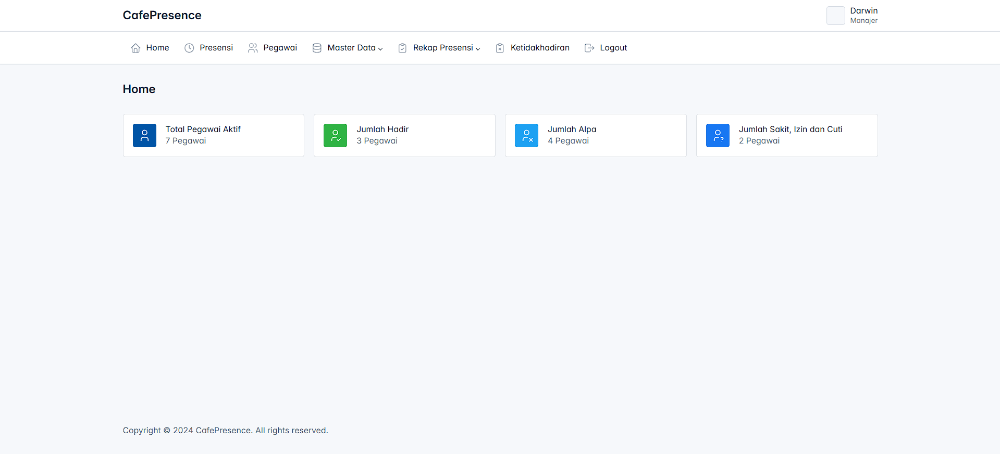
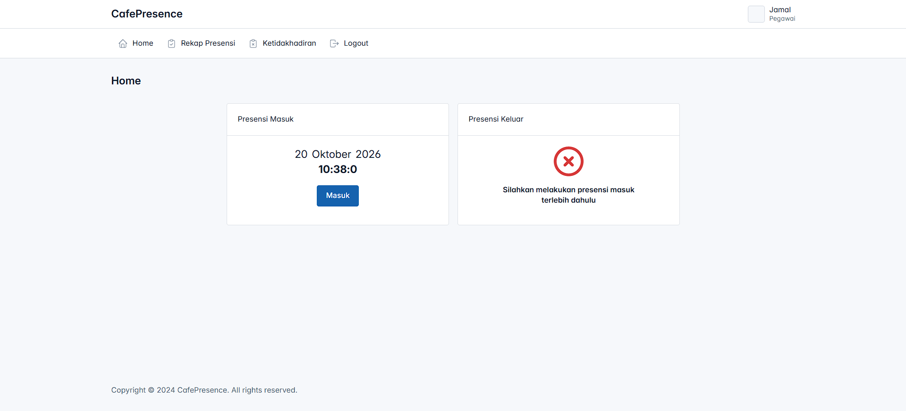
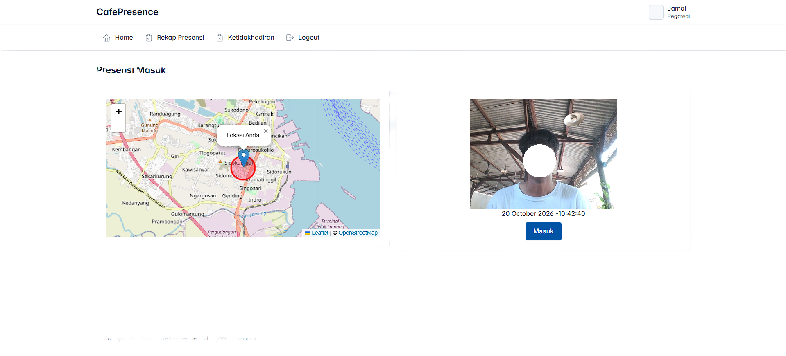
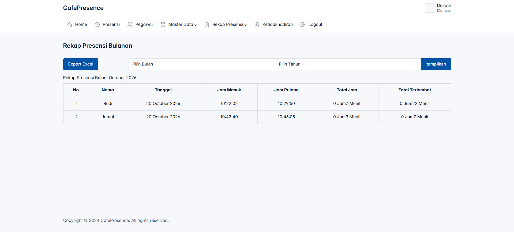

CafePresence

Aplikasi presensi pegawai berbasis web untuk cafe. Pegawai melakukan presensi masuk dan keluar dengan **foto selfie** dan **validasi lokasi (GPS)**, sedangkan admin dan manajer mengelola data pegawai serta memantau rekap kehadiran.

## Fitur

**Pegawai**
- Presensi masuk dan keluar dengan foto dari webcam
- Validasi lokasi: presensi hanya bisa dilakukan di dalam radius lokasi kerja
- Pengajuan ketidakhadiran (sakit, izin, cuti) dengan lampiran file
- Rekap presensi pribadi, profil, dan ubah password

**Admin**
- Kelola data pegawai, jabatan, dan lokasi presensi (koordinat dan radius)
- Persetujuan pengajuan ketidakhadiran
- Rekap presensi harian dan bulanan dengan **export Excel**
- Dashboard ringkasan: total pegawai aktif, hadir, alpa, sakit/izin/cuti

**Manajer**
- Akses data pegawai, jabatan, lokasi presensi, dan ketidakhadiran
- Presensi masuk dan keluar
- Rekap presensi harian dan bulanan dengan export Excel, termasuk total jam kerja dan total keterlambatan

## Tampilan Aplikasi

### Dashboard Manajer
Ringkasan jumlah pegawai aktif, hadir, alpa, serta sakit/izin/cuti.



### Beranda Pegawai
Kartu presensi masuk dan keluar. Presensi keluar baru aktif setelah pegawai melakukan presensi masuk.



### Presensi Masuk
Peta menampilkan posisi pegawai dan area radius lokasi kerja. Pegawai mengambil foto lewat webcam, lalu menekan tombol **Masuk**. Setelah berhasil, muncul notifikasi konfirmasi di halaman beranda.



### Rekap Presensi Bulanan
Tabel jam masuk, jam pulang, total jam kerja, dan total keterlambatan per pegawai. Data dapat difilter per bulan dan tahun, lalu diekspor ke Excel.



## Teknologi

| Bagian | Teknologi |
|---|---|
| Bahasa | PHP 8.2+ (mysqli) |
| Database | MySQL 8 / MariaDB 10.4+ |
| UI | Bootstrap 5, SweetAlert2 |
| Peta | Leaflet + OpenStreetMap |
| Kamera | WebcamJS |
| Export Excel | PhpSpreadsheet (via Composer) |

## Instalasi

### Kebutuhan
- Laragon atau XAMPP (PHP 8.2+ dan MySQL/MariaDB)
- Device/Browser dengan akses kamera dan lokasi

### Langkah

1. **Salin project** ke folder web server. Di Laragon: `C:\laragon\www\app_cafe_presence`
   ```bash
   git clone https://github.com/vitoagatha/app_cafe_presence.git
   ```
2. **Buat konfigurasi lokal.** `config.php` tidak disimpan di repository.
   ```bash
   cp config.example.php config.php
   ```
   Sesuaikan `$db_host`, `$db_user`, `$db_pass`, dan `$db_name` (default: `localhost`, `root`, kosong, `cafe_presense`).
3. **Siapkan database.** Buat database `cafe_presense`, lalu impor dump SQL ke dalamnya.
   Setelah itu jalankan `database/migrasi_db.sql` (menyamakan nilai `role` menjadi huruf kecil dan mencegah presensi masuk ganda).
4. **Pastikan folder upload bisa ditulis** oleh web server:
   - `assets/img/foto_pegawai/`
   - `assets/file_ketidakhadiran/`
   - `pegawai/presensi/foto/` dan `manajer/presensi/foto/`
5. **Buka aplikasi** di `http://localhost/app_cafe_presence/` lalu login.

> **Penting:** kamera dan lokasi hanya diizinkan browser di `localhost`, `127.0.0.1`, atau alamat **HTTPS**. Alamat `http://nama-situs.test` atau `http://192.168.x.x` akan diblokir. Untuk uji dari HP atau domain `.test`, aktifkan SSL di Laragon.

## Struktur Database

| Tabel | Isi |
|---|---|
| `pegawai` | Data pegawai (NIP, nama, jabatan, lokasi presensi, foto) |
| `users` | Akun login: username, password (hash), status, role |
| `jabatan` | Daftar jabatan |
| `lokasi_presensi` | Nama lokasi, koordinat, radius, jam masuk dan pulang |
| `presensi` | Presensi masuk dan keluar (tanggal, jam, foto), unik per pegawai per hari |
| `ketidakhadiran` | Pengajuan sakit/izin/cuti beserta status persetujuan |


## Struktur Folder

```
app_cafe_presence/
├── admin/            # Halaman admin (pegawai, jabatan, lokasi, rekap, dashboard)
├── manajer/          # Halaman manajer
├── pegawai/          # Halaman pegawai (presensi, ketidakhadiran, profil)
├── auth/             # Login dan logout
├── assets/           # CSS, JS, gambar, dan library (Tabler, PhpSpreadsheet)
├── docs/screenshots/ # Tangkapan layar untuk dokumentasi
├── database/         # Skrip migrasi database
├── config.example.php
└── index.php
```
